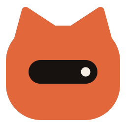
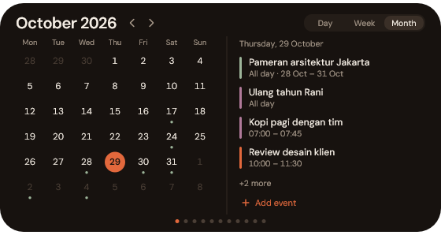
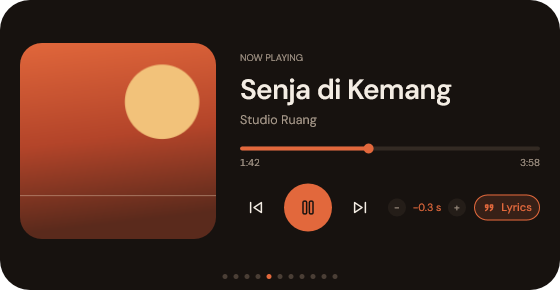
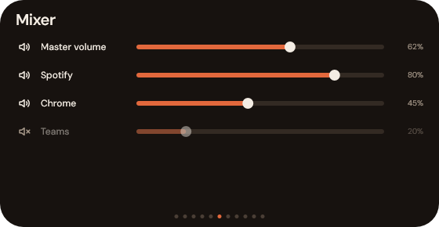
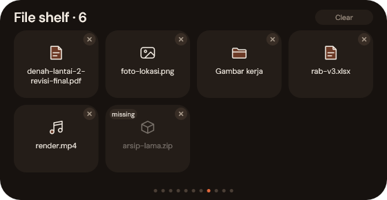
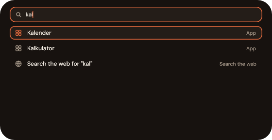
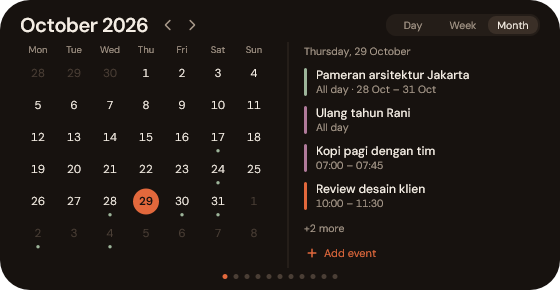
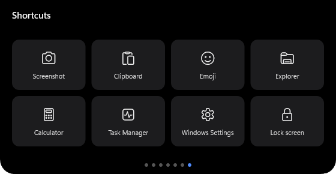

<p align="center"></p>

<h1 align="center">Vale</h1>

<p align="center"><b>A notch for the top of your Windows 11 screen.</b><br>
Music with synced lyrics, calendar, clipboard history, volume mixer, file shelf, quick search and more, one hover away.</p>

<p align="center">
  <a href="https://github.com/hartono0297/dynamic-island/releases/latest"></a>
  <a href="https://github.com/hartono0297/dynamic-island/releases"></a>
  <a href="https://github.com/hartono0297/dynamic-island/stargazers"></a>
  <a href="LICENSE"></a>
  
  
</p>

<p align="center">
  <a href="#install">Install</a> ·
  <a href="#what-it-does">Features</a> ·
  <a href="#uninstall">Uninstall</a> ·
  <a href="docs/guide.md">Guide</a> ·
  <a href="#credits">Credits</a>
</p>

<p align="center"></p>

## Why Vale

- **Native and tiny.** One exe of about 2 MB, written in Rust (Win32 and Direct2D). No browser engine, no runtime to install.
- **Made for Windows 11.** It reads Windows' own media sessions, notifications, audio and Explorer, so it works with Spotify, music in the browser, Teams and the apps you already use.
- **Yours to shape.** Open it on hover, hover-and-stay or click; reorder or hide pages; pick the accent colour, the island fill, the size of the closed notch (width and height) and a solid or see-through background, your own shortcut tiles and hotkeys. Indonesian and English.
- **Private.** Notes, reminders, clipboard and files stay on your PC. No account, no telemetry.
- **A small cat lives in the notch.** Its face and ears tell you what is going on: listening to music, focused on a pomodoro, thinking while Claude Code works, asleep when you are away.

## Install

Windows 11, 64-bit. Open **PowerShell** (no admin needed) and run:

```powershell
irm https://raw.githubusercontent.com/hartono0297/dynamic-island/main/install.ps1 | iex
```

The script downloads the latest [release](https://github.com/hartono0297/dynamic-island/releases/latest), checks its SHA-256, installs `vale.exe` to `%LOCALAPPDATA%\Programs\Vale`, adds a Start Menu shortcut and starts it. Vale then sits at the top centre of your screen, with an icon in the tray.

- **First run:** Windows asks for access to your notifications; allow it so toasts show in the notch.
- **Update:** run the same line again. Settings, notes and your Google login are kept.
- **Without the script:** download `vale-<version>.zip` from [Releases](https://github.com/hartono0297/dynamic-island/releases/latest), extract it, right-click `install.ps1` → *Run with PowerShell*. The exe also runs from any folder.
- **SmartScreen:** the exe is not code-signed yet. If Windows warns about it, choose *More info → Run anyway*.
- **Coming from Dynamic Island** (Vale's old name): installing Vale replaces it and moves your data to `%APPDATA%\Vale`.

## Uninstall

Open **PowerShell** and run:

```powershell
irm https://raw.githubusercontent.com/hartono0297/dynamic-island/main/uninstall.ps1 | iex
```

This quits Vale and removes its program folder, Start Menu shortcut, autostart entry and its Claude Code hooks. **Your data is kept** in `%APPDATA%\Vale` (settings, notes, reminders, clipboard history, Google login), so a later install picks up where you left off.

To remove your data as well:

```powershell
$env:DI_PURGE = '1'; irm https://raw.githubusercontent.com/hartono0297/dynamic-island/main/uninstall.ps1 | iex
```

Offline, the copy of the script installed next to Vale does the same:

```powershell
powershell -ExecutionPolicy Bypass -File "$env:LOCALAPPDATA\Programs\Vale\uninstall.ps1"
```

## What it does

Hover the notch to open it, scroll to change pages. The panel stays open for a few seconds after you click in it or close an editor, and every page and sub-view change glides (or is instant when Windows' animation effects are off).

| | |
|---|---|
| **Music** | Cover, controls, progress and synced lyrics in the notch. Scroll over the notch for volume, swipe or middle-click to skip. |
| **Mixer** | Master and per-app volume sliders. |
| **Clipboard** | Searchable history of text, links, colours, files and images, with pins. Password managers' copies are never kept. |
| **Screenshot** | Its own capture: the Screenshot tile freezes the screen and snaps to the window, panel or box under the pointer (or drag your own rectangle), then opens an editor with text, arrows, boxes, pen, marker and pixelate. The notch also previews PrtSc and Win+Shift+S shots, with Copy again, Keep or Delete. |
| **File shelf** | Drop files on the notch, drag them out later. Cards animate in and out. |
| **Search** | `Ctrl+Alt+Space`: apps, files and folders, calculator, Windows settings, web. |
| **Calendar** | Google Calendar with day, week and month views; add and edit events. |
| **Reminders, Notes, Pomodoro** | Quick ones, right in the panel. |
| **Notifications** | Windows toasts and [Claude Code](https://claude.com/claude-code) prompts in the notch. |
| **System** | CPU, memory, disks, the busiest apps and a cleaner that asks before it deletes. |
| **Devices** | Flash drives, external disks and memory cards, with Eject, Open, Detail and Eject all, the reason when Windows won't let go, and a notice when one is plugged in. |
| **CLI** | A small terminal that starts in your Explorer folder. |
| **Shortcuts** | Tiles for Windows tools, a jump to any panel page, Vale's own Settings, and your own apps, folders and links (added in Settings). |

<table>
  <tr>
    <td width="50%"><br><b>Music</b> with synced lyrics and a timing nudge</td>
    <td width="50%"><br><b>Mixer</b>: one slider per app</td>
  </tr>
  <tr>
    <td><br><b>Clipboard</b> history, searchable, with pins</td>
    <td><br><b>File shelf</b>: drop now, drag out later</td>
  </tr>
  <tr>
    <td><br><b>Search</b> on <code>Ctrl+Alt+Space</code></td>
    <td><br><b>System</b> at a glance, with a cleaner</td>
  </tr>
  <tr>
    <td><br><b>Calendar</b> from Google, offline too</td>
    <td><br><b>Shortcuts</b>: Windows tools, page jumps and your own tiles</td>
  </tr>
</table>

<p align="center"></p>

Everything is set in **Settings**, from the tray icon: open mode, page order, accent colours, shortcuts, hotkeys, lyrics, the cat, language. It can also stay behind your windows (experimental). Every option is described in the [guide](docs/guide.md#settings).

## Privacy

Notes, reminders, clipboard history and the shelf stay on your PC; the clipboard history file is encrypted with Windows DPAPI. Nothing is sent anywhere except to Google Calendar (when you connect it) and, with lyrics on, the artist, title and length of the playing track to [LRCLIB](https://lrclib.net). There is no telemetry. Details in the [guide](docs/guide.md#data-and-privacy).

## Build from source

Rust stable with the MSVC toolchain, and Visual Studio Build Tools with a Windows 11 SDK. From PowerShell:

```powershell
cargo build --release --locked
.\target\release\vale.exe
```

Tests: `cargo test --locked`. More in the [guide](docs/guide.md#build-from-source).

## Credits

Vale is built on the work of others, with thanks:

- **[Mole for Windows](https://github.com/tw93/Mole/tree/windows)** by tw93: the cleaner's list of safe-to-clean folders comes from Mole 1.30.0 (MIT), and the *Automatic · Mole* mode runs your own install of Mole.
- **[DM Sans and DM Mono](https://github.com/googlefonts/dm-fonts)** by Colophon Foundry for Google Fonts (SIL Open Font License 1.1), embedded in the exe.
- **[windows-rs](https://github.com/microsoft/windows-rs)** by Microsoft, with [serde](https://github.com/serde-rs/serde), [serde_json](https://github.com/serde-rs/json) and [chrono](https://github.com/chronotope/chrono) (MIT / Apache-2.0).
- **[LRCLIB](https://lrclib.net)** for synced lyrics, and the **Google Calendar API** for your events.
- **[Claude Code](https://claude.com/claude-code)** by Anthropic, through its hooks.
- Inspired by Apple's Dynamic Island. Vale is an independent project, not affiliated with Apple, Microsoft, Google, Anthropic or Spotify.

Every component with its version and licence: [THIRD-PARTY-NOTICES.md](THIRD-PARTY-NOTICES.md).

## License

[MIT](LICENSE) © 2026 hartono0297. Third-party material keeps its own licence; see [THIRD-PARTY-NOTICES.md](THIRD-PARTY-NOTICES.md) and [NOTICE](NOTICE).
