# Vale guide

The full reference: every feature, every setting, setup and troubleshooting. For a short overview and the install line, see the [README](../README.md).

**Vale was called Dynamic Island** until version 3.1. Installing 3.1 over it replaces the old install, and Vale moves your data from `%APPDATA%\DynamicIsland` to `%APPDATA%\Vale` on its first start. Version 3.1 also adds a clipboard history, a screenshot preview, a System page with a cleaner, a CLI that follows Explorer, panel pages you can reorder or hide, and one-click Google sign-in.

Design documents (in Indonesian) are in [`docs/design/`](design/).

## Install

Windows 11, 64-bit. Open **PowerShell** (no admin needed) and run:

```powershell
irm https://raw.githubusercontent.com/hartono0297/dynamic-island/main/install.ps1 | iex
```

The script downloads the latest [release](https://github.com/hartono0297/dynamic-island/releases), checks its SHA-256, installs `vale.exe` (one file, about 2 MB, no runtime needed) to `%LOCALAPPDATA%\Programs\Vale`, adds a Start Menu shortcut and starts the island.

- **Update:** run the same line again. Your settings, notes and Google login are kept.
- **Without the script:** download `vale-v<version>.zip` from Releases, extract it, right-click `install.ps1` → *Run with PowerShell*. The exe also runs from any folder.
- **Uninstall:**
  ```powershell
  irm https://raw.githubusercontent.com/hartono0297/dynamic-island/main/uninstall.ps1 | iex
  ```
  This removes the island's Claude Code hooks, autostart, shortcut and program folder. Your data stays; run `$env:DI_PURGE = '1'` first to delete it too.
- **SmartScreen:** the exe is not code-signed. If Windows warns about a downloaded exe, choose *More info → Run anyway*.

On first run, Windows asks for access to your notifications: allow it.

## Features

- **Always-visible notch** at the top centre, with a clock when idle. It hides only for fullscreen apps; clicks outside its shape pass through.
- **Hover to open the panel** (or Settings → General → *Open mode*: *Hover*, *Hover & stay* until you click elsewhere, or *Click*), scroll the mouse wheel to change pages: **Calendar → Pomodoro → Reminders → Notes → Music → Mixer → Clipboard → File shelf → System → CLI → Shortcuts**. Settings → Appearance → *Panel pages* changes the order and hides pages you don't use (a hidden page still opens from its own button or from a Shortcuts tile).
- **Calendar:** Google Calendar with Month, Week and Day views. The day view is an hour timeline with a line at the current time. Add and edit events in the island's own editor; repeating events, events over several days and events on calendars you can only view open read-only. Events can't be deleted from the island. Works offline from the last sync.
- **Pomodoro:** progress ring, start/pause/reset/skip, a small timer in the notch while it runs. Durations are set in Settings.
- **Reminders:** once, daily, or weekly on one or more days of the week, set in the island's own reminder editor with time shortcuts (*In 30 min*, *In 1 hour*, *Tonight*, *Tomorrow morning*) and a summary of when it rings next. Reminders that came due while the island was off fire at startup, marked "Missed".
- **Notes:** quick local notes, saved when the editor closes.
- **Music:** cover, title, a progress bar and controls for whatever is playing (Spotify, browser, ...), an animated equalizer in the notch, and optional synced lyrics in the notch from [lrclib.net](https://lrclib.net). The lyric notch grows with the line and scrolls a line that is still too long. A button only acts when it is both pressed and released on it, and not in the first half second after the panel opens under the pointer, so music is not paused by accident. Gestures on the island while music plays: the **wheel over the compact notch** (or over the cover on the Music page, unless you were just scrolling through pages) changes the volume, 2 % a notch while a song plays (`"scroll_volume": false` turns it off); the **middle button** plays or pauses, a **swipe** left or right (or a sideways wheel / two-finger touchpad scroll) skips to the next or previous song; `"gestures": false` in `config.json` turns them off. On the Music page, **− / +** beside *Lyrics* shift the lyric line by 0.1 s when it runs early or late.
- **Notifications:** every Windows toast shows in the island; click one to open its app. Turn on Windows *Do Not Disturb* to avoid seeing them twice (Settings → General → *Turn off Windows pop-ups* shows how). A low-battery notice comes at the threshold set in Settings.
- **Claude Code:** "Claude finished" and "Claude needs you" notices through Claude Code hooks.
- **Clipboard:** a history of what you copy (text, links, colours, files and images), searchable, with pins, in the panel. Move the pointer over a card to get its pin, plain-text and delete buttons. Password managers' copies are never kept. The history can be kept across restarts (encrypted with Windows DPAPI) or in memory only, and an optional hotkey (Ctrl+Alt+V or Win+Alt+V) opens it.
- **Screenshot (the Screenshot tile):** Vale's own capture. The screen freezes and dims; the box under the pointer lights up and follows it: first the window, then the panel, toolbar or picture inside it (found through Windows UI Automation, a moment after the windows). **Click** takes the highlighted box (or the whole monitor under the pointer when nothing is lit), **drag** draws your own rectangle, **Enter** takes the highlight, **Esc** or a **right click** cancels. The editor opens at once with the *Select* tool ready: **V** Select, **T** Text (click, type; Enter commits, a click elsewhere only finishes the text (the next click places a new one), Shift+Enter adds a line, double-click a text to edit it again), **R** Rectangle, **A** Arrow, **P** Pen, **M** Marker, **B** Pixelate; six colours and three stroke widths; **Ctrl+Z** / **Ctrl+Y** undo and redo; **Delete** removes the selected mark (drag it to move, drag a corner or an arrow's end to resize); **Ctrl+C** copies (PNG and bitmap), **Ctrl+S** saves a new `Screenshot YYYY-MM-DD HHMMSS.png` in your Screenshots folder and never overwrites a file; **Esc** cancels a text, then clears the selection, then closes (asking first if something changed). Nothing is written or copied until you press Save or Copy, and the frozen screen lives in memory only. Settings → Clipboard → *Screenshot tool* switches the tile back to Snipping Tool.
- **Screenshot preview:** after PrtSc or Win+Shift+S the notch shows the shot with *Copy again*, *Keep* and *Delete* (to the Recycle Bin, and the clipboard is emptied). What an ignored preview does is set in Settings → Clipboard; the default keeps the file.
- **System:** CPU, RAM and disk use on their own page, with one-time warnings when a drive runs low or RAM stays high. The figures glide to each new reading (once a second while the page is open, nothing runs when it is closed).
- **Quick search:** a hotkey (**Ctrl+Alt+Space** by default; Settings → General → *Search* switches it to Win+Alt+S or off, and never Alt+Space), the tray menu's *Search…* and the *Search* tile on the Shortcuts page all open the island on a search field. It finds apps (from the Start Menu, read once on first use), a few Windows settings pages, files and folders by name (from two typed characters, under Desktop, Documents, Downloads, Pictures, Videos and Music, a few levels deep; the names are read each time it opens, kept in memory only and never sent anywhere, and file contents are not searched), and does arithmetic (`2*(3+4)`, `+ - * / % ^`, brackets; Enter copies the result). `? coffee` searches the web in your browser (Google). Up / Down move, Enter runs (a file or folder opens as a double-click would), Esc or a click elsewhere closes. Icons, a folder's item count and an app's install size (when Windows knows it) fill in a moment after the rows appear.
- **Mixer:** the volume of the default output and of up to four apps playing sound (one row per program, in the order they first appeared while the page is open), plus Windows' system sounds while they play. Press or drag a slider to set a level, click the speaker to mute, scroll over a row for 5 % steps. The page reads the volumes once a second while it shows and nothing otherwise.
- **Stay behind windows (experimental):** Settings → General → *Stay behind windows* puts the island below ordinary windows. It comes up when something needs to be seen (a notice, the panel, the search) and when the pointer touches the top edge of the screen over it, and goes back down a moment after the pointer leaves. Off by default. A window covering the top-centre of the screen hides the island until the pointer touches the top edge, and over a maximised window's title bar the island rises over it. Fullscreen apps behave as before.
- **File shelf:** drag files or folders to the notch (a faint margin round it and above it catches the drag, so aim at the top edge of the screen) and the island opens on the shelf with a dashed drop zone; drop them and they stay as cards (up to 12) with their icon, a two-line name and a small X. The panel stays a moment after the drag leaves. Click a card to open the file, drag it out again to use it elsewhere (copy or link, never move), click its X to take it off or *Clear* for all. The shelf keeps paths only, not copies, and only in memory: it is empty after a restart. A card whose file is gone is dimmed.
- **Shortcuts:** Screenshot, Clipboard, Search, Emoji, Explorer, Calculator, Task Manager, Windows Settings, Lock screen, *Vale Settings* (opens Vale's own Settings window, with its own icon) and a tile that jumps straight to a panel page: Calendar, Pomodoro, Reminders, Notes, Music, Mixer, Shelf, System and CLI (Clipboard's tile already opens its page). A jump tile changes the page in place, without closing the panel, and works for a page you have switched off. New installs show the first nine, Vale Settings and Shelf; the other jump tiles are there to add. Settings → Appearance → *Shortcuts* has three parts: the tiles that show ("Shown on the page: n/12", up to twelve, four per row) in your order, each with a drag handle, up and down buttons and *Hide* (and *Delete* on your own); *Available* below, grouped as Pages, Windows, Vale and Your own, each with *+ Add* (off while twelve show); and *Restore defaults*, which puts the built-ins back in their default order and on/off and keeps your own tiles after them. *+ Your own shortcut* opens a form in the card: a name (up to 14 characters), the type (App, Folder or Web) and the target; *Browse…* opens the file or folder dialog for an app or folder. The tile is added shown when there is room, off otherwise (the form says why). The same list lives in `config.json`:
  ```json
  "shortcut_tiles": [
    { "tile": "Screenshot", "on": true },
    { "tile": "ValeSettings", "on": true },
    { "tile": "GoShelf", "on": true },
    { "tile": "GoCalendar", "on": false },
    { "tile": "Custom", "label": "Gmail", "kind": "Url", "target": "https://mail.google.com" },
    { "tile": "Custom", "label": "Projects", "kind": "Folder", "target": "D:\\Projects" },
    { "tile": "Custom", "label": "Editor", "kind": "App", "target": "C:\\Tools\\editor.exe" }
  ]
  ```
  `kind` is `App` or `Folder` (an absolute local path such as `C:\\Tools\\editor.exe`; backslashes are doubled in JSON) or `Url` (only `http`, `https`, or `mailto` without a `?`); a label has up to 14 characters, at most eight own tiles, and names are read in any case. Entries that do not pass are left out. The built-in names are `Screenshot`, `Clipboard`, `Search`, `Emoji`, `Explorer`, `Calculator`, `TaskManager`, `WindowsSettings`, `Lock`, `ValeSettings` and `Go` plus a page (`GoCalendar`, `GoPomodoro`, `GoReminders`, `GoNotes`, `GoMedia`, `GoMixer`, `GoShelf`, `GoSystem`, `GoCli`). A built-in tile you don't list rejoins right after its neighbour in the default order, shown only if it is on by default (the first nine, `ValeSettings`, `GoShelf`) and the page has room. No more than twelve tiles show: Settings will not switch a thirteenth on.
- **Clean up:** from the System page, measure and clean temp files and logs, browser and app caches, developer caches, Autodesk and Adobe caches, old installers in Downloads and old logs beside your own files (both to the Recycle Bin) and Windows Update leftovers (asks for admin through UAC). You tick what goes, and the button asks once more before anything is deleted; only files the scan counted are deleted. Open browsers and files in use are skipped and reported; the island reports the free space it measured afterwards.
- **Clean up with Mole (experimental):** the cleaner's second mode, *Automatic · Mole*, hands the clean to [Mole for Windows](https://github.com/tw93/Mole/tree/windows) if you installed it yourself (see [Mole](#mole) below).
- **CLI:** run one command at a time in PowerShell or cmd on the panel's CLI page. The island takes the keyboard only while you type: click the terminal to start (the panel stays open while you type). Esc hands the keyboard back to the app you were in; a click outside the island releases it to whatever you clicked. History suggestions (Tab, ↑), `cd`, `cls`, Stop / Ctrl+C and an enlarge button. A command keeps running while the panel is closed. The CLI starts in the folder of the last active Explorer window (or in your last folder, Settings → General), and its folder chip opens a menu of open Explorer windows, favourites and recent folders.
- **The cat, the assistant:** a small cat (a head with ears and plain black eyes) beside the clock and on the island's own notices (reminders, pomodoro, Claude Code, battery, cleaner, greeting). It has faces for idle, happy, focus, listening, singing, alert, thinking, asleep, low and waving, and its ears go up when alert and droop when asleep or low; it blinks, falls asleep after a while without activity and wakes when you point at the island. Other apps' notifications keep their own badge, and the open panel shows no cat.
- **Morning greeting:** once a day, before noon, the cat says good morning with the number of today's events and reminders, at startup, after a wake or when you unlock the PC.
- **Studio look:** the Vale palette (terracotta, espresso, cream) with six accent colours, Espresso or Graphite island fill, light/dark windows; DM Sans and DM Mono built into the exe, with titles and the clocks in DM Sans Semibold; the island's own vector icons. Pill or Notch shape. Indonesian (default) or English.

<p align="center">
  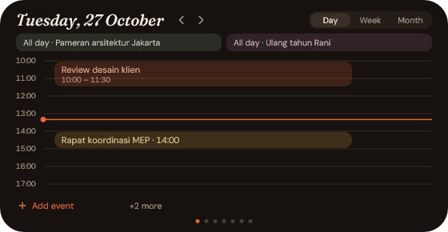
  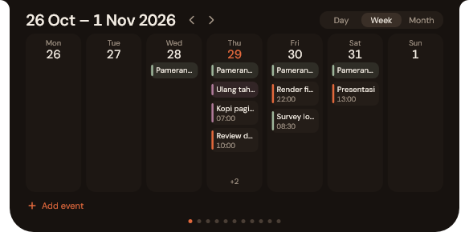
</p>

<p align="center">
  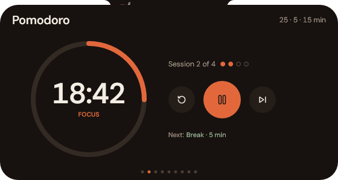
  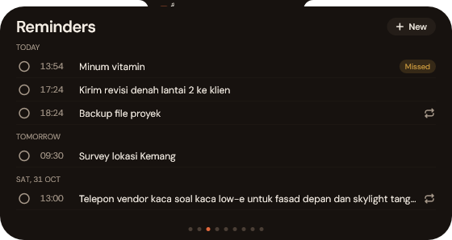
</p>

<p align="center">
  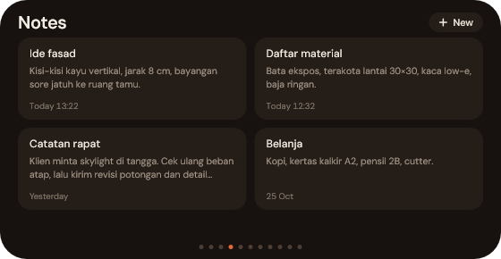
  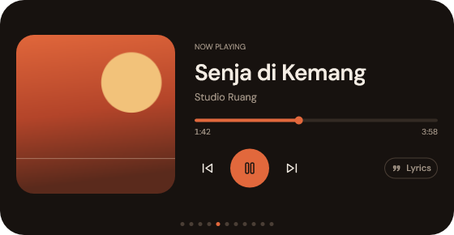
</p>

<p align="center">
  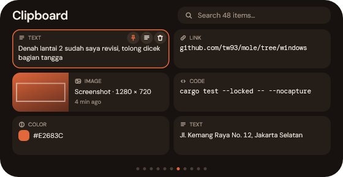
  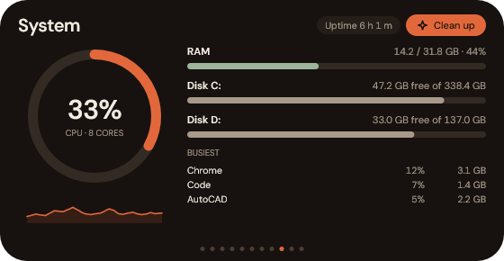
</p>

<p align="center">
  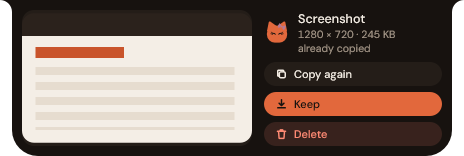
  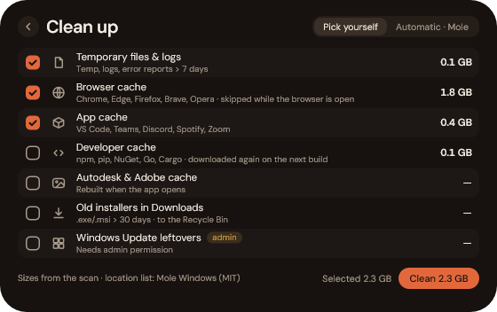
</p>

<p align="center">
  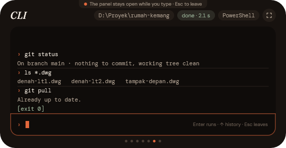
</p>

<p align="center">
  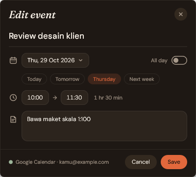
  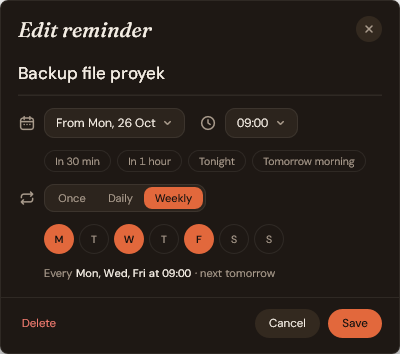
</p>

<p align="center">
  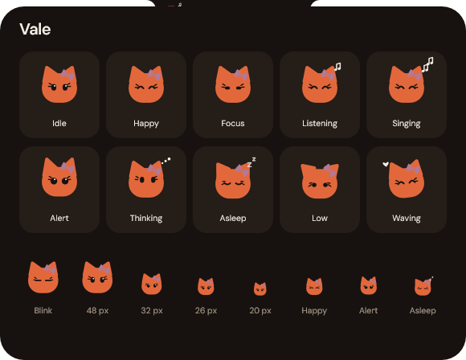
  <br>
  
</p>

## Settings

Open **Settings…** from the tray icon.

<p align="center">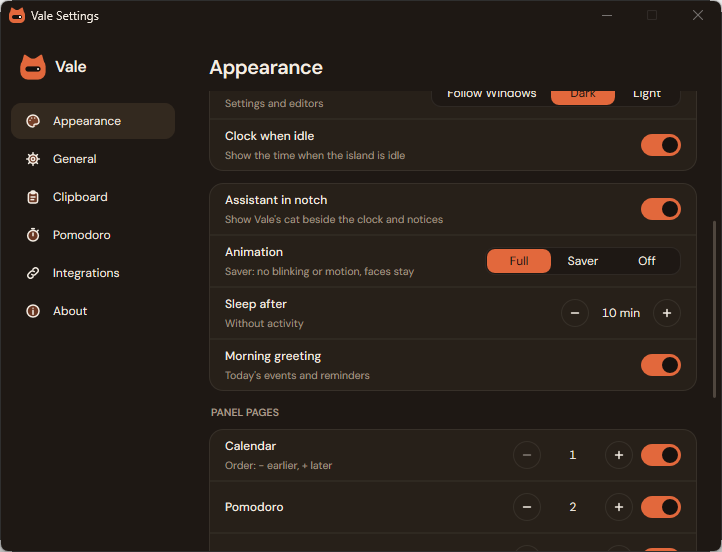</p>

| Section | What's in it |
|---|---|
| Appearance | A live preview of the island; island style (Pill / Notch), accent colour (Terracotta, Sage, Ochre, Clay, Olive, Plum), island fill (Espresso / Graphite), window mode (Follow Windows / Dark / Light), clock when idle. Then the assistant: assistant in notch (the cat on or off), animation (Full / Saver / Off), sleep after 1–60 minutes without activity, morning greeting. Then *Panel pages*: the pages the wheel shows come first, in your order, each with a drag handle, up and down buttons and *Hide* (the last page shown cannot be hidden); under *Hidden* are the others, each with *Show*; *Restore defaults* resets the list. Then *Shortcuts*: the tiles the Shortcuts page shows (up to twelve) in your order, with the same handle, buttons and *Hide* (and *Delete* for your own); *Available* with a *+ Add* for every tile that is off, grouped; *Restore defaults*; and *+ Your own shortcut*, a form for an app, a folder or a web address. Drag a handle to reorder (Esc cancels) or use the up and down buttons |
| General | Language (Indonesia / English), open mode (Hover / Hover & stay / Click), start with Windows, battery alert threshold, how to turn off Windows pop-ups, lyrics in notch, CLI shell (PowerShell / cmd) and start folder (Explorer / last folder), the quick-search hotkey, *Stay behind windows* (experimental, off by default), disk and RAM warnings, protect Cargo & Autodesk caches in Mole |
| Clipboard | History on or off, how many items, keep after restart, the optional hotkey, clear history (asks once more); the screenshot tool (Vale or Snipping Tool), the screenshot preview and what an ignored preview does |
| Pomodoro | Focus, break and long break length; sessions before a long break (locked while a pomodoro runs) |
| Integrations | Google Calendar: status, *Sign in with Google* (or your own client ID / secret under *Advanced*), Disconnect, setup guide. Claude Code: install or remove hooks |
| About | Version, source code, releases, data folder |

**Animation:** *Full* blinks, lifts the cat when you point at it and bounces on alerts. *Saver* drops the blinking and motion but keeps the faces; Full also behaves like Saver while Windows Energy Saver is on. *Off* runs no assistant timers at all: the faces still follow what happens, but the cat does not fall asleep. With the assistant off, the island looks and works as without it.

## Mole

The cleaner's *Automatic · Mole* mode runs **Mole for Windows** by tw93, a separate cleaning tool you install yourself. The island never installs, downloads, copies or links Mole: it only starts the `mole.ps1` (in `%LOCALAPPDATA%\Mole\`) or `mo` (on PATH) you already have, as a hidden process, and reads what it prints. Without Mole the mode shows a *How to install* link to Mole's Windows README.

- **Preview first:** the mode always starts with `mo clean --dry-run`, which deletes nothing. Its lines are read into four groups (browser, app, developer caches, temp files and logs); a group the island cannot read says *see log* instead of guessing a number. Mole's own summary line is never used.
- **Confirm:** *Run Mole* turns into *Sure? Delete for good* for 4 seconds; only a second click runs `mo clean`, and only with the options of the finished preview. Any other click, an option change or closing the panel disarms it. What Mole deletes is gone for good (no Recycle Bin).
- **While it runs:** Mole's log shows in the panel (colours stripped, its internal tables left out). The panel may close; the cat thinks in the notch and a notice comes at the end: happy with the free space the island measured itself (before and after, per drive), or low with a *Log* button if Mole failed.
- **Options:** *+ System (admin)* (not ticked) runs `mo clean --system` through a UAC prompt in a separate PowerShell; the island itself never runs as admin. *+ Game media > 90 days* adds `--game-media`. *Protect folders…* opens `mo clean --whitelist`.
- **Protected by default:** before Mole's first preview the island adds the Cargo caches (`.cargo\registry`, `.cargo\git`) and the Autodesk folders under AppData to Mole's whitelist (`%USERPROFILE%\.config\mole\whitelist.txt`), appending only what is missing and never changing your lines. Settings → General → *Protect Cargo & Autodesk caches in Mole* turns this off.
- **Versions:** the island was tested with Mole 1.30.x; another version shows a warning and may still run.

**Licence:** Mole's `windows` branch was relicensed from MIT to **GPL-3.0** on 2026-10-11. Because the island only runs the Mole you installed as its own process, and contains no Mole code, Mole's licence applies to Mole, not to the island.

**Claude Code hooks:** Settings → Integrations → *Install hooks* adds `Stop`, `Notification`, `UserPromptSubmit`, `PostToolUse` and `SessionEnd` hooks to `%USERPROFILE%\.claude\settings.json`. Other hooks are left alone, and a backup is kept as `settings.json.bak-vale`. Also available as `vale.exe --install-hooks` / `--uninstall-hooks`.

## Setup Google Calendar

There are two ways to connect the Calendar page:

- **Sign in with Google** (Settings → Integrations): one click, then pick your account in the browser. This uses Vale's own Google client, which is built into release builds; a build without it (for example one you build yourself) shows only the second way.
- **Your own client ID** (Settings → Integrations → *Advanced: use your own Client ID*): your own Google Cloud project, set up once as below. An own client ID, when saved, is used instead of Vale's. Switching between the two asks you to sign in again.

Setting up your own client:

1. In [Google Cloud Console](https://console.cloud.google.com/), create a new project.
2. **APIs & Services → Library** → **Google Calendar API** → **Enable**.
3. **Google Auth Platform** (OAuth consent screen) → **Get started**: any app name, your email, Audience **External**.
4. **Audience → Test users → Add users**: add the Gmail account whose calendar you want.
5. **Clients → Create client** → type **Desktop app**. Copy the **Client ID** and **Client secret** right away (the secret may be shown only once).
6. In the island: Settings → Integrations → *Advanced: use your own Client ID* → paste both → **Save** → **Connect**.
7. In the browser, pick your account, continue past "Google hasn't verified this app", and **tick both permissions**.

While the project's publishing status is **Testing**, Google expires the login after 7 days and the island asks you to reconnect. To avoid that, choose **Audience → Publish app** (*In production*); no verification is needed for personal use, and the next login lasts.

## Data and privacy

Everything lives in `%APPDATA%\Vale\`:

| File | Contents |
|---|---|
| `config.json` | Settings, including your own Google client ID / secret if you set one (plain text) |
| `notes.json`, `reminders.json` | Notes and reminders |
| `calendar-cache.json` | Last calendar data, for offline use |
| `google-token.bin` | Google login, encrypted with Windows DPAPI (only your Windows account can read it) |
| `cli-history.txt`, `cli-cwd.txt` | CLI history and folder |
| `cli-favorites.txt`, `cli-recent.txt` | The CLI folder menu's favourites and recent folders |
| `clipboard-history.bin` | The clipboard history, encrypted with Windows DPAPI; only when *Keep after restart* is on (thumbnails only, no full-size images) |
| `media.log` | Only with `--media-log`: when the island sent a media command and when playback changed (app id and state, never titles), up to 1 MB |
| `lyrics-cache\` | Lyrics already fetched |

- Nothing is sent anywhere except Google Calendar (when connected) and lrclib.net (when lyrics are on: the artist, title and length of the playing track).
- A copy that a password manager marks as private never enters the clipboard history.
- Notes and reminders are local only; there is no sync and no telemetry.

## Build from source

1. [rustup](https://rustup.rs) with the default `x86_64-pc-windows-msvc` toolchain.
2. Visual Studio 2022 Build Tools with **Desktop development with C++** and a **Windows 11 SDK**.
3. From **PowerShell or cmd** (not Git Bash, whose `link.exe` shadows the MSVC linker):
   ```powershell
   cargo build --release --locked
   .\target\release\vale.exe
   ```

The C runtime is linked statically (`.cargo/config.toml`), so the exe runs without the Visual C++ Redistributable. Quit the island first if it runs from `target\release`. Tests: `cargo test --locked`.

**Screenshots:** the images above come from the debug build's demo modes (`--demo`, `--demo-robot`, `--demo-cli`, `--demo-editor`, `--settings`). With no island running, `cargo build` and then `.\scripts\capture-screenshots.ps1` regenerates them in English.

**Releasing:** push a `vX.Y.Z` tag. `.github/workflows/release.yml` builds the exe and publishes it with its checksum and a zip.

## Troubleshooting

- **No notifications in the island:** check Windows Settings → Privacy & security → Notifications, then run `& "$env:LOCALAPPDATA\Programs\Vale\vale.exe" --probe-notifications` to print what arrives for 60 seconds.
- **"Sign-in cancelled" / "Google rejected the Client ID" (browser page after the login):** the first means the consent screen was closed or refused: press *Sign in with Google* again. The second means the saved Client ID or secret is wrong: check Settings → Integrations → *Advanced*.
- **"Add a Google client ID first":** this build has no built-in Google client (the status reads "Add a Client ID"): open Settings → Integrations → *Advanced*, paste your client ID and secret and press **Save**.
- **"Protected folder access blocked" (Windows Security) for `vale.exe` in `Pictures\Screenshots`:** Controlled folder access stops programs it does not know from creating or changing files in Pictures. The screenshot preview only reads that folder, but *Save* (when Windows made no file) and *Delete* (move to the Recycle Bin) change it. Allow it once: Windows Security → Virus & threat protection → Ransomware protection → Manage ransomware protection → Controlled folder access → *Allow an app through Controlled folder access* → pick `%LOCALAPPDATA%\Programs\Vale\vale.exe`. A new release replaces the file, so Windows may ask again.
- **"Sign in to Google again":** you switched between *Sign in with Google* and your own client ID; connect once more.
- **"Access blocked" / Error 403 from Google (own client):** your account is not a test user (step 4), or the client is not a *Desktop app*.
- **"Google Calendar API isn't enabled":** enable it (step 2) in the same project as the client, wait a few minutes, connect again.
- **"Google permissions incomplete":** connect again and tick both permissions.
- **"config.json is invalid":** usually a missing or extra comma. The island moves the broken file to `config.json.bak` on its next save; copy your values back from there.
- **Island not visible:** it hides while an app is fullscreen; only one instance can run (check the tray).

## Limits

- Primary monitor only.
- No inline replies or action buttons on notifications; apps that don't use Windows toasts aren't seen.
- Notifications are polled every second (about 2–3% of one core) because the installed exe has no package identity. Builds from source can use `scripts/package.ps1` for event-driven mode.
- Calendar is Google only; events can't be deleted from the island, and repeating events, events over several days and events on read-only calendars can't be edited. New events are single-day.
- CLI commands get no input (stdin), so interactive programs won't work; one command runs at a time.
- The pomodoro timer is not kept when the island quits.

## Fonts and credits

Vale stands on the work of others; the full list, with versions and licences, is in [`THIRD-PARTY-NOTICES.md`](../THIRD-PARTY-NOTICES.md). In short:

- **DM Sans** and **DM Mono** by Colophon Foundry for Google Fonts, embedded as Latin subsets, SIL Open Font License 1.1 ([`assets/fonts/OFL.txt`](../assets/fonts/OFL.txt)). [`scripts/make-fonts.ps1`](../scripts/make-fonts.ps1) rebuilds them from pinned upstream sources.
- **Mole for Windows** by tw93 ([github.com/tw93/Mole](https://github.com/tw93/Mole/tree/windows)): the cleaner's list of locations (which cache, temp and download folders are safe to clean, and after how many days) follows version 1.30.0, commit `500dfc4c`, © 2025 tw93, MIT; only that data is used and the island scans and deletes with its own code (full text in [`NOTICE`](../NOTICE)). The *Automatic · Mole* mode runs the Mole you installed (GPL-3.0 since 2026-10-11) as a separate program; no Mole code is copied into or linked with the island (see [Mole](#mole)).
- **Rust crates**: `windows` (Microsoft's Windows API bindings), `serde`, `serde_json`, `chrono` and their dependencies, all MIT / Apache-2.0 or similar.
- **Services**: Google Calendar API, [LRCLIB](https://lrclib.net) for synced lyrics, Google Search for web searches.
- **Works with** [Claude Code](https://claude.com/claude-code) through its hooks.

The notch idea is inspired by Apple's Dynamic Island; Vale is not affiliated with Apple or any other company named here.

Design notes and plans: [`docs/superpowers/`](superpowers/).

## License

[MIT](../LICENSE) © 2026 hartono0297. Bundled and referenced third-party material keeps its own licence, described above and in [`NOTICE`](../NOTICE).
